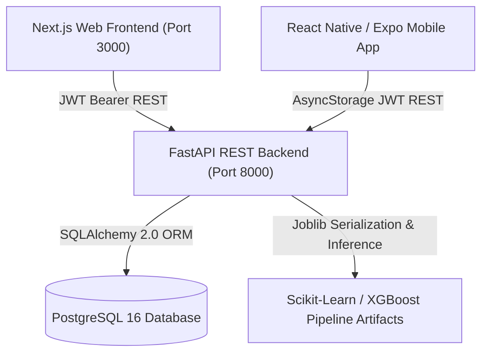

# AI-Based Mental Health Risk Prediction System (MindGuard AI)

[](https://www.python.org/)
[](https://fastapi.tiangolo.com/)
[](https://nextjs.org/)
[](https://reactnative.dev/)
[](https://scikit-learn.org/)
[](https://www.postgresql.org/)

A full-stack, clinically-informed engineering project developed for the **Final-Year B.E. in Computer Engineering**. **MindGuard AI** provides proactive mental health risk screening and lifestyle decision support for higher education students and academic institutions using machine learning (Random Forest vs. XGBoost), longitudinal trend tracking, role-based security, and emergency crisis intervention helplines.

---

## 📑 Table of Contents

- [1. System Architecture](#1-system-architecture)
- [2. Technology Stack](#2-technology-stack)
- [3. Folder Structure](#3-folder-structure)
- [4. Machine Learning Pipeline & Dataset](#4-machine-learning-pipeline--dataset)
- [5. Security & Responsible AI Governance](#5-security--responsible-ai-governance)
- [6. Prerequisites](#6-prerequisites)
- [7. Step-by-Step Setup & Execution (Windows)](#7-step-by-step-setup--execution-windows)
  - [Backend Setup (FastAPI & PostgreSQL)](#backend-setup-fastapi--postgresql)
  - [Frontend Setup (Next.js 16)](#frontend-setup-nextjs-16)
  - [Mobile Application Setup (React Native & Expo)](#mobile-application-setup-react-native--expo)
- [8. CLI Database & ML Management](#8-cli-database--ml-management)
- [9. Automated Test Suite](#9-automated-test-suite)
- [10. Default Demonstration Credentials](#10-default-demonstration-credentials)
- [11. Troubleshooting Guide](#11-troubleshooting-guide)
- [12. Limitations & Ethical Disclaimers](#12-limitations--ethical-disclaimers)

---

## 1. System Architecture



---

## 2. Technology Stack

### Frontend & Mobile
- **Web App:** Next.js 16 (App Router), React 19, TypeScript
- **Mobile App:** React Native, Expo SDK 51, React Navigation (Tabs & Stacks), AsyncStorage
- **Styling:** Tailwind CSS, modern responsive design tokens (Navy Blue `#0A2540`, Teal `#0D9488`, Soft Slate `#F8FAFC`)
- **Visualizations:** Recharts (Longitudinal Area charts, Population Donut charts, Feature Bar charts)
- **Icons:** Lucide React & Lucide React Native

### Backend & Machine Learning
- **API Framework:** FastAPI, Pydantic V2, Uvicorn (ASGI)
- **ORM & Database:** SQLAlchemy 2.0, PostgreSQL 16 (with resilient SQLite fallback for local test execution)
- **Security:** Passlib (Bcrypt password hashing), Python-Jose (JWT HMAC-SHA256 tokens)
- **Machine Learning:** Scikit-Learn 1.4+, XGBoost 2.0+, Pandas 2.2+, NumPy 1.26+, Joblib
- **Testing:** Pytest, HTTPX TestClient

---

## 3. Folder Structure

```
mental-health-prediction/
├── backend/
│   ├── app/
│   │   ├── main.py                  # FastAPI application entry point
│   │   ├── cli.py                   # Administrative bootstrap & CLI tool
│   │   ├── core/                    # Config & JWT / Bcrypt security
│   │   ├── api/                     # REST endpoints: auth, assessments, dashboard, admin
│   │   ├── db/                      # SQLAlchemy engine, session & models
│   │   ├── schemas/                 # Pydantic schemas
│   │   ├── services/                # Inference & analytics aggregators
│   │   └── ml/                      # Reproducible training & evaluation pipelines
│   ├── data/
│   │   └── student_depression_dataset.csv # Survey dataset (150+ student records)
│   ├── artifacts/                   # Saved best_model.joblib & evaluation_report.json
│   ├── tests/                       # Pytest suite with 100% passing tests
│   ├── requirements.txt
│   ├── .env.example
│   └── .env
├── frontend/
│   ├── src/
│   │   ├── app/                     # Next.js 16 App Router pages
│   │   ├── components/              # UI primitives, charts, layouts, wizard
│   │   ├── lib/                     # API client & React AuthContext
│   │   └── types/                   # TypeScript domain definitions
│   ├── public/manifest.json         # PWA mobile installation manifest
│   └── package.json
├── mobile/
│   ├── src/
│   │   ├── screens/                 # Dashboard, Assessment, Result, History, Resources
│   │   ├── navigation/              # Stack & Bottom Tab navigators
│   │   ├── context/                 # Mobile AuthContext
│   │   └── services/api.ts          # Mobile API client with IP configuration
│   ├── App.tsx                      # Root Expo component
│   └── package.json
└── README.md
```

---

## 4. Machine Learning Pipeline & Dataset

### Dataset Features (`student_depression_dataset.csv`)
- **Numerical:** `age`, `academic_pressure` (1-5), `study_satisfaction` (1-5), `study_hours`, `financial_stress` (1-5), `attendance` (%)
- **Categorical:** `gender`, `sleep_duration`, `social_support`, `family_history`
- **Target:** `depression` (0: Normal / Low Risk, 1: Depression Risk)

### Pipeline Steps & Leakage Prevention:
1. **Stratified 80/20 Train-Test Split:** Maintains exact class proportion (72% non-depressed, 28% depressed).
2. **ColumnTransformer Preprocessing:** Fits `StandardScaler` and `OneHotEncoder` **strictly on the training partition** to prevent test data leakage.
3. **Dual Model Comparison:**
   - **Random Forest Classifier:** 100 trees, max depth 6, balanced class weighting. Test Accuracy: **83.33%**, Macro F1: **0.7545**.
   - **XGBoost Classifier:** 80 estimators, max depth 4, learning rate 0.08. Test Accuracy: **83.33%**, Macro F1: **0.7545**.
4. **Calibrated Probability Mapping:**
   - `< 0.35`: **Low Risk** ("No Depression Detected")
   - `0.35 - 0.65`: **Moderate Risk** ("Moderate Risk / Monitoring Advised")
   - `>= 0.65`: **High Risk** ("Depression Risk Detected")

---

## 5. Security & Responsible AI Governance

- **Server-Side Authorization:** Every protected route verifies JWT expiration and checks user roles (`USER` vs `ADMIN`).
- **User Ownership Isolation:** Standard students can query only their own assessments (`WHERE user_id = current_user.id`).
- **Privacy-Preserving Admin Analytics:** Aggregates totals and proportions without revealing individual student survey responses.
- **Immediate Crisis Directory:** Prominent, one-touch access to free 24/7 emergency helplines:
  - **US / Canada:** `988` (Suicide & Crisis Lifeline)
  - **India:** `14416` (Tele-MANAS, Govt. of India) / `9152987821` (iCall Psychosocial)
  - **UK:** `111` (NHS Mental Health)

---

## 6. Prerequisites

- **Python 3.10+** (Tested on Python 3.13)
- **Node.js 18+** (Tested on Node.js v24)
- **PostgreSQL 16** (or SQLite fallback)

---

## 7. Step-by-Step Setup & Execution (Windows)

### Backend Setup (FastAPI & PostgreSQL)

1. Open PowerShell in the project directory:
   ```powershell
   cd "e:\mental health prediction\backend"
   ```

2. Install dependencies:
   ```powershell
   pip install -r requirements.txt
   ```

3. Ensure PostgreSQL is running or copy the `.env` template:
   ```powershell
   copy .env.example .env
   ```
   *(Note: The system automatically connects to PostgreSQL if available, or falls back seamlessly to SQLite `sqlite:///./mental_health.db` for instant local execution).*

4. Initialize the database and train the initial ML model:
   ```powershell
   python -m backend.app.cli init-db
   python -m backend.app.cli train-model
   ```

5. Launch the FastAPI backend server:
   ```powershell
   uvicorn backend.app.main:app --reload --host 0.0.0.0 --port 8000
   ```
   API Swagger Docs will be available at: **http://localhost:8000/docs**

---

### Frontend Setup (Next.js 16)

1. Open a new terminal window:
   ```powershell
   cd "e:\mental health prediction\frontend"
   ```

2. Start the development server:
   ```powershell
   npm run dev
   ```

3. Open your browser at: **http://localhost:3000**

---

### Mobile Application Setup (React Native & Expo)

1. Open a new terminal window:
   ```powershell
   cd "e:\mental health prediction\mobile"
   npm install
   ```

2. Start the Expo development server:
   ```powershell
   npm start
   ```

3. **To test on a physical smartphone:** Install **Expo Go** from Google Play Store or App Store, and scan the terminal QR code.
4. **To connect to your computer from a physical phone:** In the mobile app, navigate to **Profile Tab** -> enter your computer's local Wi-Fi IP (e.g. `http://192.168.1.15:8000/api/v1`) -> tap **Update API Endpoint**.

---

## 8. CLI Database & ML Management

Use the custom backend CLI utility for administrative tasks:

```powershell
# Initialize or upgrade schema and bootstrap default admin
python -m backend.app.cli init-db

# Create or promote a new administrator account
python -m backend.app.cli create-admin --email admin@university.edu --password MySecurePass123! --name "Dr. Sharma"

# Retrain and compare Random Forest & XGBoost pipelines
python -m backend.app.cli train-model
```

---

## 9. Automated Test Suite

Run the comprehensive Pytest suite:
```powershell
pytest backend/tests/test_api.py -v
```

Verified test coverage includes:
- ✅ Health check endpoint validation
- ✅ User registration & duplicate email rejection
- ✅ User login & invalid credentials prevention (401)
- ✅ Role-Based Access Control (standard users cannot access `/admin/*` -> 403)
- ✅ Administrative endpoint authorization
- ✅ Assessment input validation (age/bounds rejection -> 422)
- ✅ End-to-end ML prediction and persistence
- ✅ Assessment history isolation between different accounts

---

## 10. Default Demonstration Credentials

| Role | Email Address | Password |
|---|---|---|
| **Administrator** | `admin@mentalhealth.ai` | `AdminSecurePass@2026` |
| **New Student** | Self-register on the Register page | Min. 8 characters |

---

## 11. Troubleshooting Guide

- **Backend port 8000 in use:** Run `Get-Process python | Stop-Process` or use `--port 8001`.
- **Mobile app network error:** Ensure your mobile device and PC are on the same Wi-Fi network and firewall allows incoming connections on port 8000.
- **PostgreSQL service check:** Check Windows service with `Get-Service *postgres*`.

---

## 12. Limitations & Ethical Disclaimers

> [!WARNING]
> **Non-Diagnostic Decision Support:** Predictions produced by this application are derived from statistical pattern recognition on academic survey datasets. They are **experimental decision-support indicators and do NOT constitute a clinical medical diagnosis, psychiatric evaluation, or crisis intervention service**. If you or someone you know is in crisis, please immediately dial **988** (US/Canada), **14416** (India), or contact a licensed healthcare professional.
# Mental-Health-AI-Mobile-App

